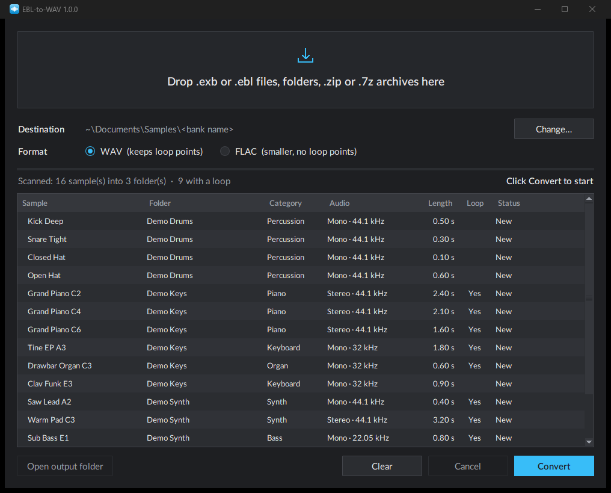

<p align="center"></p>

<h1 align="center">EBL-to-WAV</h1>

<p align="center">Convert E-mu Emulator X sound banks (<code>.exb</code> / <code>.ebl</code>) into standard
WAV or FLAC files: drag, drop, done.</p>

<p align="center"></p>

## Features

- **Emulator X banks**: drop an `.exb` file and every sample of its `SamplePool` folder is converted.
  Single `.ebl` files work too.
- **Drag and drop**: files, folders, `.zip` and `.7z` archives (unpacked automatically), several at once.
- **Scan first**: see every sample (bank, category, mono or stereo, sample rate, length, loop) and
  what will be created or replaced, then confirm with **Convert**.
- **Loops kept**: WAV files carry the original loop points, so samplers that read WAV loops
  (Renoise, Kontakt and others) loop them right away.
- **WAV or FLAC**: 16-bit WAV by default; FLAC is smaller but cannot hold loop points.
- **One folder per bank**, named after the bank, with the sample names stored in the files.
- **Fast**: a 1,800-sample bank converts in about a second.
- **Safe re-runs**: converting again replaces the earlier output and never touches files you added.

## Download

Get `EBL-to-WAV-<version>-windows-x64.zip` from the [**Releases**](../../releases/latest) page,
unzip it anywhere and run `EBL-to-WAV.exe`. No installation needed. Windows 10 or 11 (64-bit).

> Windows SmartScreen may warn about an unrecognised app the first time, because the executable
> is not code-signed: click **More info → Run anyway**.

## Usage

1. Start `EBL-to-WAV.exe`.
2. Drop `.exb` / `.ebl` files, folders or `.zip` / `.7z` archives on the window (or on the `.exe`
   icon, or click the drop zone to browse).
3. Check the scan. Nothing has been written yet: drop more files, change the format, or **Clear**.
4. Click **Convert** (or press Enter).

Output layout (default destination: `Documents\Samples`, changeable with **Change…**; the choice is remembered):

```
Samples\
└── <bank name>\              ← the .exb name (or the folder / archive name)
    ├── Piano 1 E0.wav        ← the sample name stored in the .ebl file
    ├── Piano 1 A0.wav
    └── …
```

Two samples with the same name get a number: `Kick (2).wav`.

An archive keeps its own folder layout, under a folder named after the archive. Each
`<bank>.exb` + `SamplePool` pair becomes a folder named after the bank:

```
Collection.zip                    Samples\
├── Synths\                       └── Collection\
│   └── Bank A.exb\                   ├── Synths\
│       ├── Bank A.exb                │   └── Bank A\
│       └── SamplePool\*.ebl          │       └── *.wav
└── Drums\Kit\*.ebl                   └── Drums\Kit\*.wav
```

### Where to find banks

Emulator X banks are distributed as a folder holding the `.exb` bank and a `SamplePool` folder of
`.ebl` samples. Many are archived on [archive.org](https://archive.org/details/emuexbsoundbanks).

## What gets converted

| | |
|---|---|
| Audio | 16-bit PCM, original sample rate, mono or stereo |
| Sample name | ✓ (file name) |
| Loop | ✓ in WAV (`smpl` chunk, sustain loop); not in FLAC |
| Category (Piano, Bass…) | shown in the list |
| Presets, key zones, envelopes, filters | no: only the sample pool is read, not the `.exb` bank |

## Command line

```
EBL-to-WAV.exe --cli PATH... [--out DIR] [--flac]
```

Converts without opening the window. `PATH`: `.exb` / `.ebl` files, folders or archives;
`DIR`: output folder.

## Run or build from source

Requires Python 3.12+ on Windows.

```
py -m pip install -r requirements.txt
py -m ebl_to_wav                        # the window
py -m unittest discover -s tests -v     # tests (they generate their own small .ebl files)

py -m pip install -r requirements-build.txt
py build.py                             # dist\EBL-to-WAV.exe + release .zip
```

Pushing a version tag (`v1.2.3`) makes GitHub Actions run the tests, build the `.exe` and attach
it to the release (see `.github/workflows/build.yml`).

## Credits

The `.ebl` format was first decoded by
[mattetti/e-mu-soundbanks](https://github.com/mattetti/e-mu-soundbanks) (`ebl2wav`, a command-line
tool written in Go). EBL-to-WAV is a separate implementation with a window, archive support and
loop points; the header layout it uses is documented in [`ebl_to_wav/ebl.py`](ebl_to_wav/ebl.py).

## Notes

- Please only convert sound banks you are allowed to use; most sample libraries have their own licence.
- E-mu and Emulator X are trademarks of their respective owners. This project is not affiliated
  with or endorsed by them.

## Licence

[MIT](LICENSE)
